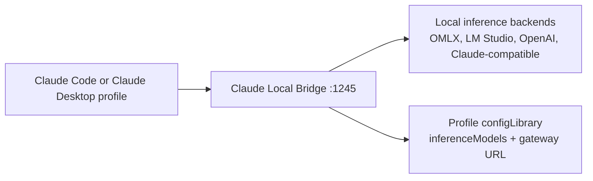

# Claude Local Bridge

Provider-neutral local bridge for Claude clients.

The bridge exposes an Anthropic-compatible local API for Claude Code and Claude
Desktop/Cowork 3P `gateway` profiles, then proxies inference requests to a
local backend such as OMLX or LM Studio. It also keeps Claude-facing model
lists usable by filtering local model discovery and, when configured, rewriting
model aliases to actual local model IDs.

## Project Path

Use the renamed generic bridge project:

```bash
cd /Users/borland/tools/claude_local_bridge
```

## Architecture



The bridge is intentionally small:

- `GET /healthz` reports provider health and selected models.
- `GET /v1/models` and `GET /api/v1/models` expose Claude-safe conversation
  model IDs.
- `POST /v1/messages` proxies Anthropic-compatible providers directly and
  adapts OpenAI-compatible providers through `/v1/chat/completions`.
- `GET /api/claude_cli/bootstrap` returns additional model picker options for
  Claude Code builds that read that bootstrap endpoint.
- `GET /sync-models` refreshes the local model cache.

The bridge does not implement inference itself. Anthropic-compatible providers
must serve `/v1/messages`; OpenAI-compatible providers must serve
`/v1/chat/completions`.

## Current Recommended Setup

Validated local setup:

- OMLX server: `http://127.0.0.1:8005`
- Bridge server: `http://127.0.0.1:1245`
- LaunchAgent label: `com.borland.claude-local-bridge`
- Default/tool route: `omlx/Qwen3.5-9b-Sushi-Coder-RL-MLX`
- Claude profiles: isolated with Electron `--user-data-dir`, usually under
  `$HOME/.claude-instances/<profile>`

Keep Claude Desktop/Cowork pointed at the bridge, not directly at OMLX. The
bridge filters embedding, reranking, image-generation, and image-quality models
out of the conversation model list.

## Claude Profiles

Claude Desktop is an Electron app. Launching it with `--user-data-dir` gives
each account/profile an isolated data directory containing login state,
settings, MCP servers, desktop extensions, and Cowork 3P config.

Recommended profile pattern:

```bash
open -n -a "/Applications/Claude.app" --args \
  --user-data-dir="$HOME/.claude-instances/work"
```

Use one dedicated profile directory per account or workflow:

- `~/.claude-instances/personal`
- `~/.claude-instances/work`
- `~/.claude-instances/cowork-local`
- `~/.claude-instances/cowork-omlx`

Do not share one profile between multiple running Claude processes. The first
process owns the login/session database; extra processes against the same
profile can appear logged out or behave inconsistently.

The profile launcher workflow is documented locally in
[`../claude_multi_launcher/README.md`](../claude_multi_launcher/README.md).
That folder is our repo-local copy/reference for the multi-instance Claude
profile gist workflow. The external provenance is
[aoxborrow's Claude profile gist](https://gist.github.com/aoxborrow/5a3a0ac0aa37819cc19439b70a552221).

## Profile Config Paths

The bridge tooling understands three ways to find a Claude Desktop/Cowork 3P
provider config.

Default stock Claude profile:

```text
$HOME/Library/Application Support/Claude-3p/configLibrary
```

Named isolated profile:

```text
$HOME/.claude-instances/<profile>/configLibrary
```

Explicit profile directory:

```text
<profile-dir>/configLibrary
```

Use a named profile with helper scripts:

```bash
export CLAUDE_PROFILE_NAME=cowork-local
```

or pass it explicitly:

```bash
./toggle_claude_local_bridge.sh --profile cowork-local --status
./refresh_omlx_cowork_models.py --profile cowork-local --apply
```

Use an explicit directory when your launcher stores profiles somewhere else:

```bash
./toggle_claude_local_bridge.sh \
  --profile-dir "$HOME/.claude-instances/work" \
  --status
```

## LaunchAgent

Install the generic bridge API as a user LaunchAgent so Claude Desktop/Cowork
can reach it whenever a profile starts. The LaunchAgent uses reloadable
provider-file mode, binds only to `127.0.0.1`, and does not embed cloud API
keys.

Prepare the ignored local provider file first:

```bash
cd /Users/borland/tools/claude_local_bridge
cp providers.example.json providers.local.json
```

Keep local providers such as OMLX and LM Studio on loopback. If you enable
cloud providers in `providers.local.json`, keep `apiKeyEnv` references and set
those secrets outside git; do not write real keys into the plist.

Copy and fill the template:

```bash
cp launchd/com.borland.claude-local-bridge.plist.template \
  "$HOME/Library/LaunchAgents/com.borland.claude-local-bridge.plist"
```

Replace placeholders:

- `__NODE_BIN__`: usually `/usr/local/bin/node` or `/opt/homebrew/bin/node`
- `__BRIDGE_DIR__`: `/Users/borland/tools/claude_local_bridge`
- `__HOME__`: `/Users/borland`

The template sets `CLAUDE_LOCAL_PROVIDERS_FILE` to
`providers.local.json`, `CLAUDE_LOCAL_BRIDGE_HOST=127.0.0.1`, and placeholder
local provider keys (`OMLX_API_KEY` / `LMSTUDIO_API_KEY`) with value
`local-bridge`. Those placeholders are fine for local providers that only need
a non-empty key; replace them only if the upstream requires a specific token.

Validate and load:

```bash
plutil -lint "$HOME/Library/LaunchAgents/com.borland.claude-local-bridge.plist"
launchctl bootstrap gui/$(id -u) \
  "$HOME/Library/LaunchAgents/com.borland.claude-local-bridge.plist"
```

After editing LaunchAgent environment variables, fully reload it. `kickstart`
alone may keep launchd's cached environment:

```bash
launchctl bootout gui/$(id -u) \
  "$HOME/Library/LaunchAgents/com.borland.claude-local-bridge.plist"
launchctl bootstrap gui/$(id -u) \
  "$HOME/Library/LaunchAgents/com.borland.claude-local-bridge.plist"
```

Check status:

```bash
launchctl print gui/$(id -u)/com.borland.claude-local-bridge
curl http://127.0.0.1:1245/healthz
```

## Environment

For one provider, generic names are enough:

```bash
export CLAUDE_LOCAL_INFERENCE_BACKEND=omlx
export CLAUDE_LOCAL_INFERENCE_BASE_URL=http://127.0.0.1:8005
export CLAUDE_LOCAL_INFERENCE_AUTH_SCHEME=x-api-key
export CLAUDE_LOCAL_INFERENCE_API_KEY=local-bridge
export CLAUDE_LOCAL_BRIDGE_HOST=127.0.0.1
export CLAUDE_LOCAL_BRIDGE_PORT=1245
export CLAUDE_LOCAL_MAIN_MODEL=omlx/Qwen3.5-9b-Sushi-Coder-RL-MLX
export CLAUDE_LOCAL_SMALL_MODEL=omlx/Qwen3.5-9b-Sushi-Coder-RL-MLX
export CLAUDE_LOCAL_TOOL_MODEL=omlx/Qwen3.5-9b-Sushi-Coder-RL-MLX
```

For multiple simultaneous providers, prefer a reloadable provider file:

```bash
cp providers.example.json providers.local.json
export CLAUDE_LOCAL_PROVIDERS_FILE=/Users/borland/tools/claude_local_bridge/providers.local.json
```

The bridge re-reads `CLAUDE_LOCAL_PROVIDERS_FILE` on every model sync. The
default sync interval is `30000` ms and can be changed with:

```bash
export CLAUDE_LOCAL_MODEL_SYNC_INTERVAL_MS=10000
```

You can also use static env-only JSON with `CLAUDE_LOCAL_PROVIDERS`:

```bash
export CLAUDE_LOCAL_PROVIDERS='[
  {
    "id": "omlx",
    "type": "anthropic",
    "baseUrl": "http://127.0.0.1:8005",
    "authScheme": "x-api-key",
    "apiKeyEnv": "OMLX_API_KEY",
    "label": "OMLX"
  },
  {
    "id": "lmstudio",
    "type": "openai",
    "baseUrl": "http://127.0.0.1:1234",
    "authScheme": "x-api-key",
    "apiKeyEnv": "LMSTUDIO_API_KEY",
    "label": "LM Studio"
  },
  {
    "id": "openai",
    "type": "openai",
    "baseUrl": "https://api.openai.com",
    "authScheme": "bearer",
    "apiKeyEnv": "OPENAI_API_KEY",
    "label": "OpenAI"
  },
  {
    "id": "anthropic",
    "type": "anthropic",
    "baseUrl": "https://api.anthropic.com",
    "authScheme": "x-api-key",
    "apiKeyEnv": "ANTHROPIC_API_KEY",
    "anthropicVersion": "2023-06-01",
    "label": "Anthropic"
  }
]'
```

Provider fields:

- `id`: stable route prefix. Exposed model IDs become `<id>/<model-id>`.
- `type`: `anthropic` for Claude-compatible `/v1/messages`, or `openai` for
  OpenAI-compatible `/v1/chat/completions`.
- `baseUrl`: provider API root, without the trailing `/v1` path when possible.
- `authScheme`: `auto`, `none`, `bearer`, `x-api-key`, or `both`.
- `apiKeyEnv`: environment variable that contains the secret key. Prefer this
  over inline `apiKey` so secrets are not written into plist files or docs.
- `label`: human-readable provider label for picker entries and diagnostics.
- `modelsFile`: optional fixture file for offline tests.

The aggregate catalog uses provider-qualified route IDs, for example:

```text
omlx/Qwen3.5-9b-Sushi-Coder-RL-MLX
lmstudio/qwen/qwen3-coder-30b
openai/gpt-4.1-mini
anthropic/claude-sonnet-4-5
```

Those route IDs are what Claude Desktop/Cowork should use in
`inferenceModels[].name`.

For backward compatibility, if neither `CLAUDE_LOCAL_PROVIDERS_FILE` nor
`CLAUDE_LOCAL_PROVIDERS` is set and the bridge is running in legacy
single-provider mode, the bridge keeps exposing raw upstream model IDs. As soon
as file/env multi-provider config is set, use provider-qualified IDs.

OpenAI-compatible providers are adapted from Anthropic `/v1/messages` to
OpenAI `/v1/chat/completions`. When Claude requests streaming for an OpenAI
provider, the bridge asks the upstream for a non-streaming chat completion and
then emits Anthropic-shaped SSE events. That preserves Claude client
compatibility, but it is buffered rather than token-by-token streaming.

## Auto-Reload

Auto-reload applies to provider-file changes, model discovery, route maps,
health state, and Claude Code model option cache. It does not reload process
environment variables because launchd and shells do not mutate a running
process environment.

Use this for reloadable provider changes:

```bash
export CLAUDE_LOCAL_PROVIDERS_FILE=/Users/borland/tools/claude_local_bridge/providers.local.json
```

Then edit `providers.local.json`. Within the next sync interval, or
immediately after calling `/sync-models`, the bridge will re-read providers,
rebuild `/v1/models`, rebuild routes, and refresh `/healthz`.

Force a reload immediately:

```bash
curl http://127.0.0.1:1245/sync-models
```

Check the active source:

```bash
curl http://127.0.0.1:1245/healthz
```

Look for `providerConfigSource` and `providerConfigReloadable`.

The LaunchAgent template expects `providers.local.json`, which is ignored by
git. Create it from `providers.example.json`, then customize enabled providers
and `apiKeyEnv` values for the machine.

Supported single-provider backend shortcuts:

- `omlx`: defaults to `http://127.0.0.1:8000`, bearer auth when auth is `auto`
- `lmstudio`: defaults to `http://127.0.0.1:1234`, `x-api-key` when auth is
  `auto`

Generic variables:

- `CLAUDE_LOCAL_INFERENCE_BACKEND`: `omlx` or `lmstudio`
- `CLAUDE_LOCAL_PROVIDERS_FILE`: reloadable provider JSON file
- `CLAUDE_LOCAL_BRIDGE_HOST`: loopback-only bridge listen host. Allowed values
  are `127.0.0.1`, `localhost`, and `::1`; unsafe values such as `0.0.0.0`
  are ignored and coerced to `127.0.0.1`.
- `CLAUDE_LOCAL_INFERENCE_BASE_URL`: overrides backend-specific URLs
- `CLAUDE_LOCAL_INFERENCE_API_KEY`: optional upstream API key
- `CLAUDE_LOCAL_INFERENCE_AUTH_SCHEME`: `auto`, `none`, `bearer`, `x-api-key`,
  or `both`
- `CLAUDE_LOCAL_INFERENCE_MODELS_FILE`: fixture JSON for offline testing
- `CLAUDE_LOCAL_MODEL_MAP`: JSON object of alias to provider-qualified route ID
- `CLAUDE_PROFILE_NAME`: profile under `~/.claude-instances`
- `CLAUDE_PROFILE_DIR`: explicit profile user-data dir

`LMSTUDIO_*`, `OMLX_*`, `OPENAI_*`, and `ANTHROPIC_*` remain provider-specific
variables. The bridge's own configuration uses `CLAUDE_LOCAL_*`.

## OMLX Setup

Start OMLX and verify model discovery:

```bash
curl http://127.0.0.1:8005/v1/models
```

Refresh the bridge/provider config from live OMLX models:

```bash
cd /Users/borland/tools/claude_local_bridge
./refresh_omlx_cowork_models.py \
  --omlx-base-url http://127.0.0.1:8005 \
  --profile cowork-local \
  --apply \
  --restart-agent
```

Dry run first if you want to inspect the planned route map:

```bash
./refresh_omlx_cowork_models.py \
  --omlx-base-url http://127.0.0.1:8005 \
  --profile cowork-local \
  --print-json
```

The refresh helper:

- fetches live OMLX `/v1/models`
- drops non-conversation models
- chooses a default/tool model by local heuristics
- writes `inferenceModels` with exact gateway model IDs
- updates `CLAUDE_LOCAL_MODEL_MAP` in the bridge LaunchAgent for compatibility
  aliases
- backs up changed provider/plist files before writing
- optionally restarts the LaunchAgent

## Claude Desktop / Cowork 3P Provider

For Anthropic's `gateway` provider mode, `inferenceModels[].name` must match an
exact model ID returned by the gateway `/v1/models` endpoint. `labelOverride`
is display-only.

Minimum provider fields:

```json
{
  "deploymentOrganizationUuid": "11111111-2222-4333-8444-555555555555",
  "coworkEgressAllowedHosts": ["*"],
  "inferenceGatewayApiKey": "local-bridge",
  "inferenceGatewayAuthScheme": "x-api-key",
  "inferenceGatewayBaseUrl": "http://127.0.0.1:1245",
  "inferenceProvider": "gateway",
  "isDesktopExtensionEnabled": true,
  "modelDiscoveryEnabled": false,
  "inferenceModels": [
    {
      "name": "omlx/Qwen3.5-9b-Sushi-Coder-RL-MLX",
      "labelOverride": "Qwen3.5 Sushi Coder 9B via Local Bridge"
    }
  ]
}
```

Important behavior:

- `modelDiscoveryEnabled: false` keeps the explicit list stable.
- `inferenceModels[0]` is the default picker entry.
- `coworkEgressAllowedHosts: ["*"]` allows Cowork/plugin/network side effects
  broadly; tighten this per profile if you want stricter egress.
- Hosted Claude models do not merge into the same 3P gateway picker. Use
  separate profiles if you want one profile on hosted Claude and another on
  local bridge-backed models.

## Toggle Per Profile

The toggle script switches one profile's active provider config between two
snapshots:

- `<provider-id>.json.bridge-on.bak`
- `<provider-id>.json.bridge-off.bak`

Check status:

```bash
./toggle_claude_local_bridge.sh --profile cowork-local --status
```

Disable bridge for that profile:

```bash
./toggle_claude_local_bridge.sh --profile cowork-local --disable
```

Enable bridge again:

```bash
./toggle_claude_local_bridge.sh --profile cowork-local --enable
```

If the first disable cannot auto-detect a pre-bridge backup, seed it:

```bash
./toggle_claude_local_bridge.sh \
  --profile cowork-local \
  --disable \
  --baseline /path/to/pre-bridge-provider.json
```

## Claude Code

Run Claude Code against the bridge:

```bash
cd /Users/borland/tools/claude_local_bridge
./run_claude_with_local_bridge.sh
```

That script:

- starts a foreground bridge for the session
- exports `ANTHROPIC_BASE_URL=http://127.0.0.1:1245`
- sets local placeholder auth values
- syncs the local model picker cache
- runs `claude`

Override backend/model choices before launching:

```bash
export CLAUDE_LOCAL_INFERENCE_BACKEND=omlx
export OMLX_BASE_URL=http://127.0.0.1:8005
export CLAUDE_LOCAL_MAIN_MODEL=omlx/Qwen3.5-9b-Sushi-Coder-RL-MLX
export CLAUDE_LOCAL_TOOL_MODEL=omlx/Qwen3.5-9b-Sushi-Coder-RL-MLX
./run_claude_with_local_bridge.sh
```

## MCP And Plugins

MCP and inference are separate layers:

- This bridge controls the primary inference API path.
- Claude Desktop profile config controls which MCP servers/extensions/plugins
  are available to that profile.
- A profile launched with `--user-data-dir` has its own MCP settings and
  desktop extension state.
- Plugin availability in Claude Desktop can still depend on Anthropic account
  or organization policy. The local bridge cannot make the official plugin
  directory show organization-managed plugins.

Recommended pattern:

- Put local inference experiments in a dedicated profile, for example
  `cowork-local`.
- Configure MCP servers inside that profile, not the stock profile.
- Use `coworkEgressAllowedHosts` per profile to decide how permissive tools and
  plugin side effects should be.
- Use [`local_llm_mcp`](../local_llm_mcp/README.md) when you want hosted Claude
  inference plus local model delegation as tools.
- Use this bridge when you want Claude's primary inference to be local.

## Model Mapping

`/v1/models` is built from every configured provider. `CLAUDE_LOCAL_MODEL_MAP`
is now for aliases such as `default`, `coder`, or Anthropic-style model names
that should route to one of those provider-qualified model IDs.

Alias mapping can make Claude Code and experiments easier:

```bash
export CLAUDE_LOCAL_MODEL_MAP='{"coder":"omlx/Qwen3.5-9b-Sushi-Coder-RL-MLX"}'
```

Anthropic-style alias mapping is also supported:

```bash
export CLAUDE_LOCAL_MODEL_MAP='{"default":"omlx/Qwen3.5-9b-Sushi-Coder-RL-MLX","claude-sonnet-4-5":"omlx/Qwen3.5-9b-Sushi-Coder-RL-MLX"}'
```

When a request includes tools and the requested model looks like an Anthropic
alias, `CLAUDE_LOCAL_TOOL_MODEL` can force a more reliable tool-calling model.
This is a bridge behavior, not an Anthropic provider config key.

## Validation

Syntax checks:

```bash
node --check bridge.mjs
bash -n run_claude_with_local_bridge.sh
bash -n toggle_claude_local_bridge.sh
python3 -m py_compile refresh_omlx_cowork_models.py
node --test ../tests/claude_local_bridge/bridge.test.mjs
```

The Node test suite starts loopback-only stub providers and a loopback bridge
process. In sandboxed runners, allow local `127.0.0.1` listener binds for this
command.

Offline model sync with fixture:

```bash
CLAUDE_LOCAL_INFERENCE_MODELS_FILE=omlx-models.current.example.json \
CLAUDE_GLOBAL_CONFIG_FILE=/tmp/claude-local-bridge-test.json \
node bridge.mjs sync-models
```

Live checks:

```bash
curl http://127.0.0.1:1245/healthz
curl http://127.0.0.1:1245/v1/models
```

Logs:

```bash
tail -f "$HOME/Library/Logs/claude-local-bridge.log"
```

## Files

- `bridge.mjs`: provider-neutral Anthropic-compatible proxy
- `run_claude_with_local_bridge.sh`: Claude Code launcher
- `toggle_claude_local_bridge.sh`: Desktop/Cowork profile toggle
- `refresh_omlx_cowork_models.py`: live OMLX model refresh helper
- `claude-3p-provider.example.json`: editable provider example
- `launchd/com.borland.claude-local-bridge.plist.template`: LaunchAgent template
## Safety Notes

- Do not commit real API keys, tokens, profile databases, or `.env` files.
- Use placeholder local tokens such as `local-bridge` for localhost auth.
- The bridge API intentionally binds to loopback only. Keep
  `CLAUDE_LOCAL_BRIDGE_HOST` as `127.0.0.1`, `localhost`, or `::1`; the bridge
  refuses wildcard/external bind hosts.
- Back up provider JSON before hand-editing it.
- Restart the exact Claude profile you changed; other profiles have separate
  config and may continue using their old provider state.
