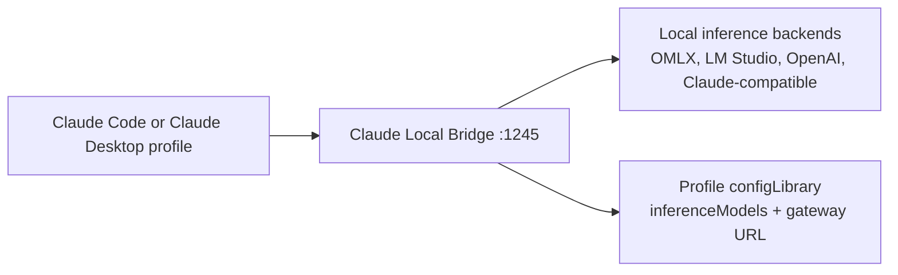

# Claude Local Bridge

Provider-neutral local bridge for Claude clients.

The bridge exposes an Anthropic-compatible local API for Claude Code and Claude
Desktop/Cowork 3P `gateway` profiles, then proxies inference requests to a
local backend such as OMLX or LM Studio. It also keeps Claude-facing model
lists usable by aggregating local model discovery and, when configured,
rewriting model aliases to actual local model IDs.

## Project Path

Use the renamed generic bridge project:

```bash
cd /Users/borland/tools/claude_local_bridge
```

## Architecture



The bridge is intentionally small:

- `GET /healthz` reports provider health and selected models.
- `GET /v1/models` and `GET /api/v1/models` expose every discovered provider
  model plus any configured Claude-facing aliases.
- `POST /v1/messages` proxies Anthropic-compatible providers directly and
  adapts OpenAI-compatible providers through `/v1/chat/completions`.
- Image-bearing Claude alias requests can be routed to a dedicated vision
  model with `models.vision` / `CLAUDE_LOCAL_VISION_MODEL`.
- `GET /api/claude_cli/bootstrap` returns additional model picker options for
  Claude Code builds that read that bootstrap endpoint.
- `GET /sync-models` refreshes the local model cache.
- `generate_claude_3p_config.py` generates Claude Desktop/Cowork
  `configLibrary` entries for isolated 3P profiles.

The bridge does not implement inference itself. Anthropic-compatible providers
must serve `/v1/messages`; OpenAI-compatible providers must serve
`/v1/chat/completions`.

## Current Recommended Setup

Validated local setup:

- OMLX server: `http://127.0.0.1:8005`
- Bridge server: `http://127.0.0.1:1245`
- LaunchAgent label: `com.borland.claude-local-bridge`
- API default/tool/vision route: `aggregator-anthropic/anthropic/claude-opus-5-5`
  (stable picker alias `claude-opus-5-404289`)
- API small route: `aggregator-anthropic/claude-haiku-5-5`
- **Auto Routing** uses oMLX for chat, tools, and images.
- Claude profiles: isolated with Electron `--user-data-dir`, usually under
  `$HOME/.claude-instances/<profile>`

Keep Claude Desktop/Cowork pointed at the bridge, not directly at OMLX. The
bridge aggregates every discovered provider model. Capability hints still
inform request routing and default-model heuristics, but they do not remove
models from discovery.

Enable `omlx` in `providers.local.json` alongside the gateway providers. Set
`capabilityFallback: false` on the oMLX provider to keep explicit oMLX
selections local. Add these fields to `bridge.local.json`, merging the alias
entries into the existing `claudeDesktopModels` list:

```json
{
  "autoRouting": {
    "chat": "claude-omlx-gemma-e4b",
    "tools": "claude-omlx-sushi-coder",
    "vision": "claude-omlx-gemma-e4b"
  },
  "claudeDesktopModels": [
    {
      "name": "claude-omlx-gemma-e4b",
      "target": "omlx/gemma-4-e4b-it-4bit",
      "labelOverride": "OMLX: Gemma 4 E4B",
      "toolCapable": true,
      "visionCapable": true
    },
    {
      "name": "claude-omlx-sushi-coder",
      "target": "omlx/Qwen3.5-9b-Sushi-Coder-RL-MLX",
      "labelOverride": "OMLX: Qwen 3.5 Sushi Coder",
      "toolCapable": true
    }
  ]
}
```

Select **Auto Routing** (`claude-auto-routing`) to use these rules. Requests containing images use
`vision`, even when they also include tools, so that target should support both.
Other requests with tools use `tools`, and the rest use `chat`. The entry is
published only when all three targets are available. Fixed gateway selections
keep their own model and Auto Routing does not become a family default.

## Claude Profiles

Claude Desktop is an Electron app. Launching it with `--user-data-dir` gives
each account/profile an isolated data directory containing login state,
settings, MCP servers, desktop extensions, and Cowork 3P config.

Recommended profile pattern:

```bash
open -n -a "/Applications/Claude.app" --args \
  --user-data-dir="$HOME/.claude-instances/work"
```

Use one dedicated profile directory per account or workflow:

- `~/.claude-instances/personal`
- `~/.claude-instances/work`
- `~/.claude-instances/cowork-local`
- `~/.claude-instances/cowork-omlx`

Do not share one profile between multiple running Claude processes. The first
process owns the login/session database; extra processes against the same
profile can appear logged out or behave inconsistently.

The profile launcher workflow is documented locally in
[`../claude_multi_launcher/README.md`](../claude_multi_launcher/README.md).
That folder is our repo-local copy/reference for the multi-instance Claude
profile gist workflow. The external provenance is
[aoxborrow's Claude profile gist](https://gist.github.com/aoxborrow/5a3a0ac0aa37819cc19439b70a552221).

## Profile Config Paths

The bridge tooling understands three ways to find a Claude Desktop/Cowork 3P
provider config.

Default stock Claude profile:

```text
$HOME/Library/Application Support/Claude-3p/configLibrary
```

Named isolated profile:

```text
$HOME/.claude-instances/<profile>/configLibrary
```

Explicit profile directory:

```text
<profile-dir>/configLibrary
```

Use a named profile with helper scripts:

```bash
export CLAUDE_PROFILE_NAME=cowork-local
```

or pass it explicitly:

```bash
./toggle_claude_local_bridge.sh --profile cowork-local --status
./refresh_omlx_cowork_models.py --profile cowork-local --apply
```

Use an explicit directory when your launcher stores profiles somewhere else:

```bash
./toggle_claude_local_bridge.sh \
  --profile-dir "$HOME/.claude-instances/work" \
  --status
```

## LaunchAgent

Install the generic bridge API as a user LaunchAgent so Claude Desktop/Cowork
can reach it whenever a profile starts. The LaunchAgent plist stays minimal:
it only runs `bridge.mjs serve` from this directory. Runtime settings live in
`bridge.local.json`, so normal changes do not require editing XML.

Prepare the ignored local config files first:

```bash
cd /Users/borland/tools/claude_local_bridge
cp bridge.config.example.json bridge.local.json
cp providers.example.json providers.local.json
```

`bridge.local.json` is loaded from the LaunchAgent `WorkingDirectory`, which is
`/Users/borland/tools/claude_local_bridge`. It points at `providers.local.json`
by default. Keep local providers such as OMLX and LM Studio on loopback. If you
enable cloud providers, keep `apiKeyEnv` references and set those secrets
outside git; do not write real keys into the plist.

Copy and fill the template:

```bash
cp launchd/com.borland.claude-local-bridge.plist.template \
  "$HOME/Library/LaunchAgents/com.borland.claude-local-bridge.plist"
```

Replace placeholders:

- `__NODE_BIN__`: usually `/usr/local/bin/node` or `/opt/homebrew/bin/node`
- `__BRIDGE_DIR__`: `/Users/borland/tools/claude_local_bridge`
- `__HOME__`: `/Users/borland`

The template keeps an empty `EnvironmentVariables` dict on purpose. The bridge
defaults to `bridge.local.json` in the working directory. That JSON file sets
the bridge host/port, model defaults, provider file, sync interval, non-streaming
and streaming request timeouts, and placeholder local provider keys.

Validate and load:

```bash
plutil -lint "$HOME/Library/LaunchAgents/com.borland.claude-local-bridge.plist"
launchctl bootstrap gui/$(id -u) \
  "$HOME/Library/LaunchAgents/com.borland.claude-local-bridge.plist"
```

After editing the plist itself, fully reload it. `kickstart` is enough for
normal `bridge.local.json` setting changes, but plist edits are cached by
launchd:

```bash
launchctl bootout gui/$(id -u) \
  "$HOME/Library/LaunchAgents/com.borland.claude-local-bridge.plist"
launchctl bootstrap gui/$(id -u) \
  "$HOME/Library/LaunchAgents/com.borland.claude-local-bridge.plist"
```

Check status:

```bash
launchctl print gui/$(id -u)/com.borland.claude-local-bridge
curl http://127.0.0.1:1245/healthz
```

## JSON Configuration

For launchd, prefer `bridge.local.json` in the bridge working directory:

```bash
cp bridge.config.example.json bridge.local.json
```

The installed LaunchAgent intentionally avoids bridge settings in the plist.
Keep runtime settings in `bridge.local.json`; the bridge reads JSON values before
falling back to process environment variables. `CLAUDE_LOCAL_CONFIG_FILE` is the
only env var normally needed, and only when you want to point the process at a
non-default config file.

Claude profile paths also live in JSON. For the local 3P profile used by this
setup:

```json
{
  "claude": {
    "profileName": "local-3p"
  }
}
```

Use `claude.profileDir` for an explicit profile directory,
`claude.globalConfigFile` for a specific config file, or `claude.configDir` for
a non-default Claude config root.

For one provider, use the `singleProvider` object:

```json
{
  "bridge": { "host": "127.0.0.1", "port": 1245 },
  "singleProvider": {
    "backend": "omlx",
    "baseUrl": "http://127.0.0.1:8005",
    "authScheme": "x-api-key",
    "apiKey": "local-bridge"
  },
  "models": {
    "main": "omlx/Qwen3.5-9b-Sushi-Coder-RL-MLX",
    "small": "omlx/Qwen3.5-9b-Sushi-Coder-RL-MLX",
    "tool": "omlx/Qwen3.5-9b-Sushi-Coder-RL-MLX",
    "vision": "omlx/Qwen3-VL-4B-Instruct-4bit"
  }
}
```

For multiple simultaneous providers, prefer a reloadable provider file:

```json
{
  "providersFile": "providers.local.json",
  "modelSyncIntervalMs": 30000,
  "modelDiscoveryTimeoutMs": 30000
}
```

The bridge re-reads `providersFile` on every model sync. The default sync
interval is `30000` ms and can be changed with `modelSyncIntervalMs`.
`modelDiscoveryTimeoutMs` is the per-provider timeout for `/v1/models`
catalog fetches. Keep it comfortably above the slowest configured provider;
cloud aggregators such as gateway can take longer than 5 seconds to return a
large catalog.

You can also embed static providers directly in `bridge.local.json`:

```json
{
  "providers": [
    {
      "id": "omlx",
      "type": "anthropic",
      "baseUrl": "http://127.0.0.1:8005",
      "authScheme": "x-api-key",
      "apiKeyEnv": "OMLX_API_KEY",
      "label": "OMLX"
    }
  ],
  "env": {
    "OMLX_API_KEY": "local-bridge"
  }
}
```

Provider fields:

- `id`: stable route prefix. Exposed model IDs become `<id>/<model-id>`.
- `type`: `anthropic` for Claude-compatible `/v1/messages`, or `openai` for
  OpenAI-compatible `/v1/chat/completions`.
- `baseUrl`: provider API root, without the trailing `/v1` path when possible.
- `authScheme`: `auto`, `none`, `bearer`, `x-api-key`, or `both`.
- `apiKeyEnv`: environment variable name to resolve. The bridge checks
  `bridge.local.json` `env` first, then the process environment. For real cloud
  keys, prefer a local ignored config file or an OS secret workflow; never put
  secrets in the plist or tracked docs.
- `label`: human-readable provider label for picker entries and diagnostics.
- `modelsFile`: optional fixture file for offline tests.
- `local`: optional boolean. Defaults to `true` for loopback providers such as
  `127.0.0.1`, `localhost`, OMLX, and LM Studio. Local routes are treated as
  timeout-risk by default because they may spend long periods loading,
  pre-filling, or thinking before visible text appears.
- `slow`: optional boolean. Set `true` for any provider whose first visible
  token can arrive late enough to trigger Claude Desktop's stream-idle
  watchdog, even if the provider is remote.
- `timeoutRisk`: optional boolean. This is the direct switch for the visible
  stream timeout guard. If unset, it inherits from `local || slow`. Set
  `false` on a local provider/model only if you explicitly do not want the
  bridge to emit visible progress heartbeats for that route.
- `toolCapable`: optional provider-wide structured tool-use policy. Set
  `false` for providers or model aggregators that can chat but have not been
  verified to return real Anthropic/OpenAI tool-call objects; this overrides
  stale manual alias flags and lets tool requests fall back to `models.tool`.
  Set `true` only for providers where every advertised conversation model is
  known to support structured tool calls.
- `toolFormat`: optional provider-wide tool response format. Use `text` only
  for providers where tool-enabled responses are known to return text tags such
  as `<tool_call>{"name":"Bash","arguments":{...}}</tool_call>` or
  `<function=Read>{"file_path":"..."}</function>`; the bridge will parse those
  tags, validate the tool name and required input fields against the request,
  and return structured Anthropic `tool_use` blocks to Claude. Leave unset for
  native Anthropic or OpenAI tool-call objects.
- `toolCapableModels`: optional list of exact upstream model IDs qualified for
  tools. When present, this overrides provider/model hints and stale manual
  alias flags. It reports capability; it does not hide other discovered models.
- `capabilityFallback`: defaults to `true`. Set `false` to preserve an explicitly
  selected provider/model for tools and images. Unsupported requests then return
  that provider's error rather than silently running another model.
- `systemFormat`: set `text` for gateways that reject Anthropic system content
  arrays. Text blocks are joined in order; system-block cache hints are omitted.
- `stripUnsignedThinking`: omit unsigned thinking and empty text from assistant
  history before forwarding it. Signed thinking is retained. This handles gateway
  responses whose null thinking signatures fail its own request validation.
- `modelApiTypes`: optional map of upstream model ID to `openai`, selecting
  `/v1/chat/completions` for that model on an otherwise Anthropic provider.
  Provider identity, credentials, model ID, and picker alias stay the same.

Internally, the aggregate catalog uses provider-qualified route IDs, for example:

```text
omlx/Qwen3.5-9b-Sushi-Coder-RL-MLX
lmstudio/qwen/qwen3-coder-30b
openai/gpt-4.1-mini
anthropic/claude-sonnet-4-5
aggregator-anthropic/<model-id>
aggregator-openai/<model-id>
```

Claude Code and direct bridge callers can use those route IDs. Claude
Desktop/Cowork 3P gateway discovery is stricter: expose Claude-compatible model
IDs and map each alias to the real route ID. The bridge does this
automatically by default for every discovered conversation model that does not
already have a manual alias. This lets Claude see an alias such as
`claude-sonnet-5-482913` while the bridge sends
`provider-id/<real-model-id>` upstream.

Manual `claudeDesktopModels[]` entries are still supported and win over
automatic aliases. Use them for stable favorite names, family defaults, or
capability overrides.

For backward compatibility, if neither `providersFile` nor `providers` is set
and the bridge is running in legacy single-provider mode, the bridge keeps
exposing raw upstream model IDs. As soon as JSON multi-provider config is set,
use provider-qualified IDs. Legacy env-only provider config is still parsed as a
fallback for tests and one-off runs, but the LaunchAgent setup should keep
settings in JSON.

OpenAI-compatible providers are adapted from Anthropic `/v1/messages` to
OpenAI `/v1/chat/completions`. When Claude requests streaming for an OpenAI
provider, the bridge asks the upstream for a non-streaming chat completion and
then emits Anthropic-shaped SSE events. That preserves Claude client
compatibility, but it is buffered rather than token-by-token streaming.

### gateway

`providers.example.json` includes disabled gateway templates for both
compatibility surfaces:

- `aggregator-anthropic`: Anthropic-compatible `/v1/messages` routing.
- `aggregator-openai`: OpenAI-compatible `/v1/chat/completions` routing.

Both use `https://api.aggregator.ai` as the provider root. Do not append `/v1`; the
bridge probes the standard model-list paths for the selected provider type.

The templates preserve gateway selections for all requests, including tool use
and images. They normalize system prompts and unsigned thinking for the current
gateway. OpenAI adaptation preserves assistant tool calls, matching tool-result
messages, parallel calls, error results, and tool-choice settings across turns.
Its client-facing SSE emits empty block starts followed by argument deltas.

Gemini 4 Hydrogen/Neon use gateway's OpenAI endpoint even under the
`aggregator-anthropic` picker entries: the native Anthropic translation loses Gemini's
tool signature during continuation. This selects another protocol for the same
model, without switching providers or models. See the
[upstream LiteLLM signature issue](https://github.com/BerriAI/litellm/issues/46369)
and [signature transport documentation](https://docs.litellm.ai/docs/providers/gemini).

Qualify the current catalog instead of assuming every advertised deployment is
usable. This makes paid API calls with synthetic prompts and inert receipt
results; it never executes model-selected shell commands or accesses your files:

```bash
python3 qualify_aggregator.py --model qwen3.8-max \
  --model anthropic/claude-opus-5-5 --stream-tools \
  --output ../tmp/aggregator-streamed-tools.json
python3 qualify_aggregator.py --all-models --timeout 30 \
  --output ../tmp/aggregator-all-models.json
```

The report checks Claude-shaped model validation, token counting, structured
tool name/arguments, and streamed continuation containing an unpredictable
confirmation supplied only in the tool result. `--stream-tools` also exercises
the initial tool response over SSE. Plain prose claiming a tool ran does not
pass. Reports include synthetic response bodies, failures, and elapsed times;
nonzero exit status means some checks failed. Populate `toolCapableModels` from
successful qualifications; new models remain discoverable without a false
capability claim. Authentication errors, retired upstream deployments, timeouts,
and missing structured calls need separate investigation. These checks do not
qualify vision, every tool-choice mode, or full coding-agent behavior.

Use automatic tool choice with the current Claude 5.5 deployments: the upstream
rejects forced `tool`/`any` choices. The bridge preserves that error rather than
silently weakening the caller's requested tool policy.

To enable gateway locally, edit ignored local files only. Put the real key in
`bridge.local.json`:

```json
{
  "env": {
    "AGGREGATOR_API_KEY": "replace-with-your-real-local-key"
  }
}
```

Then set one or both gateway provider entries in `providers.local.json` to
`"enabled": true`. Prefer enabling `aggregator-anthropic` first if gateway's
Anthropic-compatible surface is available, because that route requires less
translation for Claude Desktop/Cowork. After changing the file:

```bash
curl -X POST http://127.0.0.1:1245/sync-models
curl http://127.0.0.1:1245/healthz
curl http://127.0.0.1:1245/v1/models
```

## Tool And Vision Routing

Claude Desktop/Cowork can choose internal Claude-family aliases that differ
from the model label selected in the UI. For example, an image prompt may be
sent as an opus-family request even when the profile later shows a sonnet-family
model. The bridge therefore treats tools and images as request capabilities,
not just picker labels.

When a request includes tools and the requested model looks like an Anthropic
alias, the bridge first checks whether the selected route is tool-capable. If
it is, the tool-shaped request stays on that selected model. If it is not,
`models.tool` or `CLAUDE_LOCAL_TOOL_MODEL` can force a more reliable
tool-calling model. When a request includes Anthropic image content blocks and
the requested model looks like an Anthropic alias, the bridge applies the same
pattern for vision: selected vision-capable routes stay selected, and
non-vision routes fall back to `models.vision` or
`CLAUDE_LOCAL_VISION_MODEL`. Exact provider-qualified model IDs, such as
`omlx/Qwen3-VL-4B-Instruct-4bit`, are left alone because they are not
Anthropic aliases.

For the current OMLX setup, keep:

```json
{
  "models": {
    "main": "claude-sonnet-4-5",
    "small": "claude-haiku-4-5",
    "tool": "claude-sonnet-4-5",
    "vision": "claude-haiku-4-5-20251001"
  }
}
```

The `claude-haiku-4-5-20251001` alias maps to
`omlx/Qwen3-VL-4B-Instruct-4bit`. This avoids routing image prompts to
`Qwen3.6-35B-A3B-Claude-Opus-VL-grafted-MLX-8bit`, which has been observed to
fail in OMLX with `409 Conflict` and a VLM load error about missing parameters.
Models that are tested and known to handle images, such as
`Qwen3.6-27B-Heretic-MLX-bf16`, can set `visionCapable: true` on their
Claude-facing alias so image requests selected from that alias are not
redirected to the fallback vision route.
Models that should keep tool-shaped Claude requests, even when
`models.tool` points elsewhere, can set `toolCapable: true` on their
Claude-facing alias.

## Auto-Reload

Auto-reload applies to `bridge.local.json`, provider-file changes, model
discovery, route maps, health state, and Claude Code model option cache. It
does not reload process environment variables because launchd and shells do not
mutate a running process environment. Keep reloadable settings in
`bridge.local.json`. It also does not reload changed JavaScript source code;
restart the LaunchAgent after changing `bridge.mjs`.

Use this for reloadable provider changes:

```json
{
  "providersFile": "providers.local.json"
}
```

Then edit `providers.local.json`. Within the next sync interval, or
immediately after calling `/sync-models`, the bridge will re-read providers,
rebuild `/v1/models`, rebuild routes, and refresh `/healthz`.

Force a reload immediately:

```bash
curl http://127.0.0.1:1245/sync-models
```

Check the active source:

```bash
curl http://127.0.0.1:1245/healthz
```

Look for `providerConfigSource` and `providerConfigReloadable`.

The LaunchAgent template expects `providers.local.json`, which is ignored by
git. Create it from `providers.example.json`, then customize enabled providers
and `apiKeyEnv` values for the machine.

Supported single-provider backend shortcuts:

- `omlx`: defaults to `http://127.0.0.1:8000`, bearer auth when auth is `auto`
- `lmstudio`: defaults to `http://127.0.0.1:1234`, `x-api-key` when auth is
  `auto`

Generic variables:

- `CLAUDE_LOCAL_INFERENCE_BACKEND`: `omlx` or `lmstudio`
- `CLAUDE_LOCAL_PROVIDERS_FILE`: reloadable provider JSON file
- `CLAUDE_LOCAL_BRIDGE_HOST`: loopback-only bridge listen host. Allowed values
  are `127.0.0.1`, `localhost`, and `::1`; unsafe values such as `0.0.0.0`
  are ignored and coerced to `127.0.0.1`.
- `CLAUDE_LOCAL_INFERENCE_BASE_URL`: overrides backend-specific URLs
- `CLAUDE_LOCAL_INFERENCE_API_KEY`: optional upstream API key
- `CLAUDE_LOCAL_INFERENCE_AUTH_SCHEME`: `auto`, `none`, `bearer`, `x-api-key`,
  or `both`
- `CLAUDE_LOCAL_INFERENCE_MODELS_FILE`: fixture JSON for offline testing
- `CLAUDE_LOCAL_MODEL_MAP`: JSON object of alias to provider-qualified route ID
- `CLAUDE_PROFILE_NAME`: profile under `~/.claude-instances`
- `CLAUDE_PROFILE_DIR`: explicit profile user-data dir

`LMSTUDIO_*`, `OMLX_*`, `OPENAI_*`, and `ANTHROPIC_*` remain provider-specific
variables. The bridge's own configuration uses `CLAUDE_LOCAL_*`.

## OMLX Setup

Start OMLX and verify model discovery:

```bash
curl http://127.0.0.1:8005/v1/models
```

Refresh the bridge/provider config from live OMLX models:

```bash
cd /Users/borland/tools/claude_local_bridge
./refresh_omlx_cowork_models.py \
  --omlx-base-url http://127.0.0.1:8005 \
  --profile cowork-local \
  --apply \
  --restart-agent
```

Dry run first if you want to inspect the planned route map:

```bash
./refresh_omlx_cowork_models.py \
  --omlx-base-url http://127.0.0.1:8005 \
  --profile cowork-local \
  --print-json
```

The refresh helper:

- fetches live OMLX `/v1/models`
- keeps the bridge provider model list complete
- generates Claude-compatible aliases for local models suitable for primary
  chat inference
- chooses a default/tool model by local heuristics
- writes `inferenceModels` with Claude-compatible gateway alias IDs
- updates `bridge.local.json` and `providers.local.json`
- backs up changed provider/config files before writing
- optionally restarts the LaunchAgent

## Claude Desktop / Cowork 3P Provider

For Anthropic's `gateway` provider mode, Claude filters `/v1/models` through
its Anthropic model catalog. Do not expose raw local IDs such as
`omlx/Qwen3.5-9b-Sushi-Coder-RL-MLX` directly to Claude Desktop. Configure
`claudeDesktopModels[]` in `bridge.local.json` so `/v1/models` returns
Claude-compatible aliases, and set `inferenceModels[].name` to those aliases.
`labelOverride` is display-only and should carry the real local model label.

The generator follows Anthropic's Claude Desktop 3P configuration reference:
local user configs live under `configLibrary`, `_meta.json` selects the active
entry, gateway configs use `inferenceGatewayBaseUrl`,
`inferenceGatewayApiKey`, and `inferenceGatewayAuthScheme`, and
`inferenceModels[].name` must be the exact model ID returned by the gateway.
The official reference also notes that managed macOS/Windows policy stores
encode array/object keys as JSON strings, while local `configLibrary` files use
normal JSON values.

Minimum provider fields:

```json
{
  "deploymentOrganizationUuid": "11111111-2222-4333-8444-555555555555",
  "coworkEgressAllowedHosts": ["*"],
  "inferenceGatewayApiKey": "local-bridge",
  "inferenceGatewayAuthScheme": "x-api-key",
  "inferenceGatewayBaseUrl": "http://127.0.0.1:1245",
  "inferenceProvider": "gateway",
  "isDesktopExtensionEnabled": true,
  "modelDiscoveryEnabled": false,
  "inferenceModels": [
    {
      "name": "claude-sonnet-4-5",
      "labelOverride": "Qwen3.5 Sushi Coder 9B via Local Bridge",
      "anthropicFamilyTier": "sonnet",
      "isFamilyDefault": true
    }
  ]
}
```

Important behavior:

- `modelDiscoveryEnabled: false` keeps the explicit list stable.
- `inferenceModels[0]` is the default picker entry.
- `inferenceModels[].name` must match the Claude-facing ID returned by the
  bridge `/v1/models`, not the hidden upstream local model ID.
- `coworkEgressAllowedHosts: ["*"]` allows Cowork/plugin/network side effects
  broadly; tighten this per profile if you want stricter egress.
- Hosted Claude models do not merge into the same 3P gateway picker. Use
  separate profiles if you want one profile on hosted Claude and another on
  local bridge-backed models.

### Generate A Profile Config

Use `generate_claude_3p_config.py` when you want to reproduce or repair the
Claude Desktop/Cowork 3P provider entry itself. It uses the working
`~/.claude-instances/local-3p/configLibrary` profile as the default base, keeps
the local bridge fields aligned with the official 3P `gateway` shape, and is
dry-run by default.

Dry run against the local-3p profile and print the generated config with
sensitive fields redacted:

```bash
cd /Users/borland/tools/claude_local_bridge
./generate_claude_3p_config.py \
  --profile local-3p \
  --spec claude-3p-generator.example.json \
  --print-json
```

Apply the generated config to the same profile:

```bash
./generate_claude_3p_config.py \
  --profile local-3p \
  --spec claude-3p-generator.example.json \
  --apply
```

Generate a separate profile from the local-3p base:

```bash
./generate_claude_3p_config.py \
  --base-profile local-3p \
  --profile cowork-omlx \
  --name "Local OMLX Bridge" \
  --config-id "$(uuidgen)" \
  --apply
```

Model sources:

- `bridge-config`: default; reads `claudeDesktopModels[]` from
  `bridge.local.json`.
- `bridge-live`: fetches `GET /v1/models` from the bridge and keeps only
  Claude-compatible `claude-*` aliases, including automatic aliases.
- `base`: reuses `inferenceModels` from the base config.
- `file`: reads a JSON file containing `inferenceModels`, `data`, `models`, or
  `items`.

Permissive single-user defaults:

- `permissive: true` is the example-spec default. Pass `--strict-local` or set
  `permissive: false` when you want a smaller generated config.
- Public egress is open with `coworkEgressAllowedHosts: ["*"]`.
- Workspace access is open with `allowedWorkspaceFolders: [{"path": "/"}]`.
  Leaving this key unset is also unrestricted, but the generator writes it
  explicitly so the local profile is self-documenting.
- Built-in tools and bundled skills are enabled with
  `disabledBuiltinTools: []`, `disableBundledSkills: false`, and
  `builtinToolPolicy: {"*": "allow"}`.
- Chat, Code, Cowork, Auto mode, tool search, advanced file analysis, local dev
  MCP, persistent MCP approvals, and unsigned desktop extensions are enabled.
- `managedMcpServers` defaults to an empty list, ready for explicit local or
  remote MCP server entries in the spec.
- Plugin-delivered MCP tools are pre-approved through `orgPluginSettings`, and
  the Anthropic `knowledge-work-plugins` and `claude-plugins-official`
  repositories are exposed through `allowedPluginMarketplaces`.

Gateway extras supported by the spec:

- `gateway.customHeaders`: writes `inferenceCustomHeaders`.
- `gateway.oidc`: writes `inferenceGatewayOidc`.
- `gateway.sessionLifetimeSec`: writes `inferenceSessionLifetimeSec`.
- Model entries preserve `supports1m`, `prefer1m`,
  `anthropicFamilyTier`, and `isFamilyDefault` when present.
- `workspace`, `connectors`, `plugins`, `usageLimits`, `appearance`,
  `updates`, `telemetry`, `bootstrap`, `source`, and `extra` sections map to
  the same top-level keys used by Claude's 3P configuration reference.

Secret handling:

- By default, generated configs use placeholder localhost auth such as
  `local-bridge` instead of preserving copied secret fields.
- Pass `--preserve-secret-values` only for private local profile generation.
- Do not commit generated profile configs containing real keys, custom
  inference headers, or profile account state.

### If Claude Shows "Gateway Returned No Usable Models"

When `curl http://127.0.0.1:1245/v1/models` returns models but the Claude 3P
settings screen reports "found 0 models" or "Gateway returned no usable
models", check the IDs in the response. If they are raw local/provider IDs such
as `omlx/Qwen3.5-9b-Sushi-Coder-RL-MLX`, Claude reached the bridge but filtered
them out because they are not Anthropic catalog IDs.

Fix the active profile config by setting:

```json
{
  "modelDiscoveryEnabled": false,
  "inferenceModels": [
    {
      "name": "claude-sonnet-4-5",
      "labelOverride": "Qwen3.5 Sushi Coder 9B via Local Bridge",
      "anthropicFamilyTier": "sonnet",
      "isFamilyDefault": true
    }
  ]
}
```

Use alias IDs copied exactly from the bridge `/v1/models` response. The bridge
routes those aliases to provider-qualified local targets configured in
`bridge.local.json`.

After editing the config file, fully quit and reopen the exact Claude profile.
Claude reads the 3P config once at launch. If the in-app settings dialog was
already open, choose `Discard Changes` before relaunching; applying a stale
dialog can overwrite the static `inferenceModels` list and put the profile back
into discovery-only mode.

## Toggle Per Profile

The toggle script switches one profile's active provider config between two
snapshots:

- `<provider-id>.json.bridge-on.bak`
- `<provider-id>.json.bridge-off.bak`

Check status:

```bash
./toggle_claude_local_bridge.sh --profile cowork-local --status
```

Disable bridge for that profile:

```bash
./toggle_claude_local_bridge.sh --profile cowork-local --disable
```

Enable bridge again:

```bash
./toggle_claude_local_bridge.sh --profile cowork-local --enable
```

If the first disable cannot auto-detect a pre-bridge backup, seed it:

```bash
./toggle_claude_local_bridge.sh \
  --profile cowork-local \
  --disable \
  --baseline /path/to/pre-bridge-provider.json
```

## Claude Code Profiles

Use Claude profiles instead of a launcher shell script. The bridge runs as a
LaunchAgent on `http://127.0.0.1:1245`, and the profile in
`/Users/borland/.claude-instances/local-3p` carries the third-party gateway
settings. Keep backend/model choices in `bridge.local.json`:

```json
{
  "singleProvider": {
    "backend": "omlx",
    "baseUrl": "http://127.0.0.1:8005"
  },
  "models": {
    "main": "omlx/Qwen3.5-9b-Sushi-Coder-RL-MLX",
    "tool": "omlx/Qwen3.5-9b-Sushi-Coder-RL-MLX"
  }
}
```

After editing JSON, sync the profile-facing model cache if needed:

```bash
cd /Users/borland/tools/claude_local_bridge
node bridge.mjs sync-models
```

Then launch the desired Claude Desktop/Cowork profile using the
`claude_multi_launcher` tooling, or open the already-configured local 3P
profile.

## MCP And Plugins

MCP and inference are separate layers:

- This bridge controls the primary inference API path.
- Claude Desktop profile config controls which MCP servers/extensions/plugins
  are available to that profile.
- A profile launched with `--user-data-dir` has its own MCP settings and
  desktop extension state.
- Plugin availability in Claude Desktop can still depend on Anthropic account
  or organization policy. The local bridge cannot make the official plugin
  directory show organization-managed plugins.

Recommended pattern:

- Put local inference experiments in a dedicated profile, for example
  `cowork-local`.
- Configure MCP servers inside that profile, not the stock profile.
- Use `coworkEgressAllowedHosts` per profile to decide how permissive tools and
  plugin side effects should be.
- Use [`local_llm_mcp`](../local_llm_mcp/README.md) when you want hosted Claude
  inference plus local model delegation as tools.
- Use this bridge when you want Claude's primary inference to be local.

## Model Mapping

`/v1/models` is built from every configured provider and includes every
discovered provider model, independent of inferred capabilities. Embedding,
reranking, vision, image-quality, and other specialized models remain visible
and routable by their provider-qualified IDs. Capability hints only affect
automatic fallback routing for tool/image requests and default-model selection.

`CLAUDE_LOCAL_MODEL_MAP` is now for aliases such as `default`, `coder`, or
Anthropic-style model names that should route to one of those provider-qualified
model IDs.

For Claude Desktop/Cowork 3P, automatic aliases are enabled by default:

```json
{
  "autoClaudeDesktopAliases": true
}
```

The bridge creates aliases only for discovered conversation models and skips
non-chat entries such as embeddings, rerankers, and image-only models. Alias
labels are provider-prefixed and descriptions preserve the exact upstream model
ID. Set `autoClaudeDesktopAliases` to `false` if you want the picker to show
only manually configured aliases.

Automatic alias names are stable. The six-digit suffix is derived from a hash
of `provider-id/<real-model-id>`, so a model keeps its alias when other models
are added, removed, or reordered, and across bridge restarts. Upstream IDs that
already look like `claude-*` keep that name when it is free. Only a hash
collision within the same tier moves a name, to the next free suffix. The tier
(`opus`, `sonnet`, `haiku`) is guessed from the model ID, so use a manual
`claudeDesktopModels[]` entry when you want a specific tier or a friendlier
name.

Claude Desktop/Cowork profiles store a static `inferenceModels` list. Refresh it
after the bridge's model list changes so new aliases appear in the picker, for
example with `generate_claude_3p_config.py --models-source bridge-live`.

Use `claudeDesktopModels[]` in `bridge.local.json` for hand-curated aliases.
These aliases are added alongside raw provider models and automatic aliases,
not used as a replacement list:

```json
{
  "claudeDesktopModels": [
    {
      "name": "claude-sonnet-4-5",
      "target": "omlx/Qwen3.5-9b-Sushi-Coder-RL-MLX",
      "labelOverride": "OMLX: Qwen3.5 Sushi Coder 9B",
      "description": "OMLX source model: Qwen3.5-9b-Sushi-Coder-RL-MLX",
      "anthropicFamilyTier": "sonnet",
      "isFamilyDefault": true
    }
  ]
}
```

- `name`: Claude-facing model ID returned by `/v1/models`.
- `target`: provider-qualified local route ID or raw upstream model ID.
- `labelOverride`: local model label shown in Claude's picker. Prefer
  `<Provider>: <Real upstream model>` so the picker shows both the source
  provider and the original model identity.
- `description`: optional longer source note. Prefer
  `<Provider> source model: <exact upstream model id>` so diagnostics and
  generated profile JSON preserve the exact route behind the Claude-compatible
  alias.
- `anthropicFamilyTier`: optional Claude tier mapping for alias resolution.
- `toolCapable`: optional boolean; when true, tool-shaped requests selected
  through this alias stay on this route instead of falling back to
  `models.tool`. Provider-level `toolCapable: false` wins over this alias flag.
  Keep this false or unset for models that write tool calls as literal text
  such as `<tool_call>` instead of returning structured tool-use blocks.
- `toolFormat`: optional alias-level format override. Set `text` for a specific
  model that writes `<tool_call>` JSON blocks; this opt-in is stronger than
  provider-level `toolCapable: false` and enables bridge-side normalization for
  that alias only.
- `visionCapable`: optional boolean; when true, image requests selected through
  this alias stay on this route instead of falling back to `models.vision`.
- `local`, `slow`, `timeoutRisk`: optional alias-level overrides for the
  visible timeout guard. These inherit from the target route by default. Use
  them when a single alias needs different behavior from its provider.
- `maxContextLength` / `max_model_len`: optional override for the advertised
  alias context window; by default aliases inherit the target model's upstream
  context metadata.
- `isFamilyDefault`: optional winner when several entries share a tier.

Every usable local conversation model should have exactly one Claude-facing
alias. When several local models use the same `anthropicFamilyTier`, give each
one a different Claude model version alias, for example `claude-opus-4-5` and
`claude-opus-4-1`. The refresh helper validates this and refuses to write a
partial or duplicate alias table.

### Context Windows

The bridge preserves provider context-window metadata in `/v1/models`. OMLX
reports this as `max_model_len`; the bridge forwards it for raw provider routes
and for Claude-facing aliases. Check what Claude/config tooling can discover:

```bash
curl -s http://127.0.0.1:1245/v1/models | jq '.data[] | {id, max_model_len}'
```

This is the advertised model capacity. OMLX also has a runtime cap in
`~/.omlx/settings.json` at `sampling.max_context_window`; if that value is lower
than a model's `max_model_len`, the OMLX runtime cap is the practical limit.
For long Cowork/code tasks, keep the OMLX runtime context window at least as
large as the models exposed through the bridge.

Current local OMLX desktop aliases:

```text
claude-sonnet-4-5          -> omlx/Qwen3.5-9b-Sushi-Coder-RL-MLX
claude-opus-4-5            -> omlx/Qwen3-Next-80B-A3B-Instruct-4bit
claude-mythos-5            -> omlx/Qwen3-Next-80B-A3B-Thinking-4bit
claude-sonnet-4-6          -> omlx/Qwen3.6-27B-Heretic-MLX-bf16
claude-opus-4-1            -> omlx/Qwen3.6-35B-A3B-MLX-4bit
claude-fable-5             -> omlx/gemma-4-12b-coder-fable5-composer2.5-8bit
claude-haiku-4-5           -> omlx/gemma-4-e4b-it-4bit
claude-haiku-4-5-20251001  -> omlx/Qwen3-VL-4B-Instruct-4bit
```

Alias mapping can make Claude Code and experiments easier:

```bash
export CLAUDE_LOCAL_MODEL_MAP='{"coder":"omlx/Qwen3.5-9b-Sushi-Coder-RL-MLX"}'
```

Anthropic-style alias mapping is also supported:

```bash
export CLAUDE_LOCAL_MODEL_MAP='{"default":"omlx/Qwen3.5-9b-Sushi-Coder-RL-MLX","claude-sonnet-4-5":"omlx/Qwen3.5-9b-Sushi-Coder-RL-MLX"}'
```

When a request includes tools or image content and the requested model looks
like an Anthropic alias, `CLAUDE_LOCAL_TOOL_MODEL` and
`CLAUDE_LOCAL_VISION_MODEL` can force more reliable capability-specific models.
Tool fallback is skipped when the selected route is marked `toolCapable: true`.
Set provider-level `toolCapable: false` for aggregators whose model catalog
does not reliably distinguish structured tool support; otherwise Claude may
display raw tool-call text instead of executing tools.
If a specific model can use tools but returns a different format, prefer a
manual alias with `toolFormat: "text"` instead of marking the entire provider
tool-capable. The bridge only parses text tool calls when the request includes
tools and validates the parsed name and required input fields against the
declared tool list before returning a `tool_use` block. Empty or incomplete
tool tags such as `<function=Read></function>` are consumed instead of being
forwarded to Claude as broken tool calls.
Vision fallback is skipped when the selected route is already marked or
detected as vision-capable. This is bridge behavior, not an Anthropic provider
config key.

## Validation

Syntax checks:

```bash
node --check bridge.mjs
bash -n toggle_claude_local_bridge.sh
python3 -m py_compile refresh_omlx_cowork_models.py
python3 -m py_compile generate_claude_3p_config.py
jq . bridge.config.example.json providers.example.json claude-3p-provider.example.json claude-3p-generator.example.json >/dev/null
node --test ../tests/claude_local_bridge/bridge.test.mjs
pytest ../tests/claude_local_bridge/generate_claude_3p_config.test.py
```

The Node test suite starts loopback-only stub providers and a loopback bridge
process. In sandboxed runners, allow local `127.0.0.1` listener binds for this
command.

Offline model sync with fixture:

```bash
CLAUDE_LOCAL_INFERENCE_MODELS_FILE=omlx-models.current.example.json \
CLAUDE_GLOBAL_CONFIG_FILE=/tmp/claude-local-bridge-test.json \
node bridge.mjs sync-models
```

Live checks:

```bash
curl http://127.0.0.1:1245/healthz
curl http://127.0.0.1:1245/v1/models
```

Logs:

```bash
tail -f "$HOME/Library/Logs/claude-local-bridge.log"
tail -f "$HOME/.omlx/logs/server.log"
```

The bridge log shows local routing decisions, such as
`claude-sonnet-4-6 -> omlx/Qwen3.6-27B-Heretic-MLX-bf16`. The OMLX server log is the
source of truth for upstream model load failures, token generation timings, and
image parser errors. The OMLX dashboard log viewer at
`http://127.0.0.1:8005/admin/dashboard?tab=logs` reads from the same log
directory and rotates daily files like `server.log.2026-07-29`.

Each proxied request also gets a short bridge request id in log lines, for
example `[bridge:000a]`. Grep that id to follow one request from route
selection through upstream response, progress updates, completion, or mid-stream
failure. Stream-failure logs include elapsed time, selected Claude-facing model,
upstream provider model, event/byte counts, visible-output count, progress
update count, and the last sampled provider status from OMLX when available.

### If Claude Shows "Stream Idle Timeout"

Claude Desktop may display `API Error: Stream idle timeout - no chunks
received` when the gateway does not send a usable streaming event quickly
enough. This can happen with local OMLX models during model load, prompt
prefill, long tool-context requests, or when a selected model stalls before
emitting text.

For the current slow OMLX models, use a 15-second visible idle heartbeat. Claude
Desktop appears to tolerate long total generations when it receives occasional
visible chunks, but it can fail if the stream stays visually quiet for too long.
The recommended guard starts after 8 seconds and then ensures the transcript
gets a compact heartbeat at least every 15 seconds until real model output
arrives.

The bridge starts Anthropic SSE responses immediately for streaming
`/v1/messages` requests by sending an early `message_start` event, then sends
periodic `ping` events while waiting for the upstream provider. When OMLX later
emits its own `message_start`, the bridge filters that duplicate event and
continues proxying the real content blocks.

Slow local models can still spend a long time in hidden thinking or prefill
without emitting visible assistant text. Claude Desktop's local-agent watchdog
may ignore SSE `ping`, lifecycle events, and hidden thinking chunks. To keep
slow models usable, the local config enables a visible stream timeout guard:

```json
{
  "modelDiscoveryTimeoutMs": 30000,
  "requestTimeoutMs": 600000,
  "streamRequestTimeoutMs": 3600000,
  "streamingProgress": {
    "enabled": true,
    "delayMs": 8000,
    "intervalMs": 15000,
    "idleHeartbeatMs": 15000,
    "providerStatusEnabled": true,
    "providerStatusTimeoutMs": 1200
  }
}
```

`modelDiscoveryTimeoutMs` applies to provider model-list requests such as
`/v1/models`, including the discovery that powers Claude model picker aliases.
`requestTimeoutMs` applies to short non-streaming calls such as
`/v1/messages/count_tokens`. `streamRequestTimeoutMs` applies to streaming
`/v1/messages` generations after Claude is already connected to the bridge.
Keep it much longer than the normal timeout for slow local models; Heretic-sized
OMLX prompts can spend more than 10 minutes in prefill before producing visible
answer text. Set `streamRequestTimeoutMs` to `0` only if you want no bridge-side
absolute timeout for streaming requests.

Thinking handling is configured separately:

```json
{
  "thinking": {
    "mode": "passthrough-with-progress"
  }
}
```

`passthrough-with-progress` is the default. It passes real upstream Anthropic
`thinking` content blocks and `thinking_delta` events through so Claude can
render the model's thought process when the provider emits it. If the provider
does not produce usable thinking or visible output before `streamingProgress`
fires, the bridge still falls back to the local status block.

Use `passthrough` to show upstream thinking without the extra status fallback,
or `suppress` / `status-only` to hide upstream thinking and keep the older
visible-progress behavior. The bridge does not synthesize private chain of
thought for models that do not emit Anthropic thinking events; it only forwards
what the upstream provider actually streams.

When enabled, the bridge applies this only to streaming routes marked
`timeoutRisk: true`. Providers or models marked `local: true` or `slow: true`
inherit `timeoutRisk: true` unless they explicitly override it. This keeps cloud
providers from showing local prefill/status text by default, while still
protecting OMLX, LM Studio, and other slow local routes from Claude's stream
idle watchdog. For timeout-risk routes, the bridge waits `delayMs` for upstream
visible text or tool output. If none arrives, it emits the smallest visible
heartbeat it can, then appends occasional one-line italic updates until the real
upstream text/tool output begins.

`idleHeartbeatMs` is the important idle limit. Status updates are still
deduplicated when OMLX reports the same phase/progress bucket, but once the
stream has been quiet for this many milliseconds the bridge emits another
compact heartbeat anyway. Set it lower if Claude still reports idle timeouts;
set it to `0` only if you want strict dedupe and accept the idle-timeout risk.

Example:

```markdown
_Local model: queued, position 1 (12s)._

_Local model: prefill 24.1k / 29.8k tokens (80%), about 1m 58s left (42s)._
```

For OMLX providers, `providerStatusEnabled` lets the bridge fetch
`/admin/api/activity` while waiting. When available, the visible heartbeat stays
minimal and includes only the most useful phase, queue, prefill, or ETA detail;
full model, memory, event-count, and provider diagnostics stay in the bridge log
instead of the Claude transcript. The status fetch is
best-effort and bounded by `providerStatusTimeoutMs`, so it cannot block or fail
the model stream. Repeated updates are deduplicated by provider phase and coarse
progress bucket unless the idle heartbeat limit has elapsed, so Claude does not
render a long wall of near-identical status lines. This intentionally trades a
tiny visible heartbeat for reliable long-running local inference. If you see a
line such as `_Local model: prefill ..._` while a cloud model is selected, check
the bridge log for a capability fallback such as `route model "..." ->
omlx/...`; the selected alias likely fell back to a local `models.tool` or
`models.vision` route. Set `"streamingProgress": {"enabled": false}` to disable
the visible timeout guard; set `"providerStatusEnabled": false` to keep the
guard but use generic messages.
If the error still appears:

```bash
curl http://127.0.0.1:1245/healthz
tail -f "$HOME/Library/Logs/claude-local-bridge.log"
tail -f "$HOME/.omlx/logs/server.log"
```

Look for bridge entries like `upstream stream failed ... Premature close`,
which usually means the upstream stream closed before Anthropic SSE completed.
The request id suffix includes details such as `lastStatus=prefill:...` or
`lastStatus=activity:...`; pair that with OMLX entries showing model unloads,
request cancellations, or long hidden thinking phases without visible text
deltas. If OMLX reports a model as
unavailable after a cached load failure, remove that model from
`bridge.local.json` or remap its Claude alias to a known-working local model,
then restart the launchd service.

## Files

- `bridge.mjs`: provider-neutral Anthropic-compatible proxy
- `toggle_claude_local_bridge.sh`: Desktop/Cowork profile toggle
- `refresh_omlx_cowork_models.py`: live OMLX model refresh helper
- `bridge.config.example.json`: tracked bridge runtime config template
- `claude-3p-provider.example.json`: editable provider example
- `launchd/com.borland.claude-local-bridge.plist.template`: LaunchAgent template
## Safety Notes

- Do not commit real API keys, tokens, profile databases, or `.env` files.
- Use placeholder local tokens such as `local-bridge` for localhost auth.
- The bridge API intentionally binds to loopback only. Keep
  `CLAUDE_LOCAL_BRIDGE_HOST` as `127.0.0.1`, `localhost`, or `::1`; the bridge
  refuses wildcard/external bind hosts.
- Back up provider JSON before hand-editing it.
- Restart the exact Claude profile you changed; other profiles have separate
  config and may continue using their old provider state.
